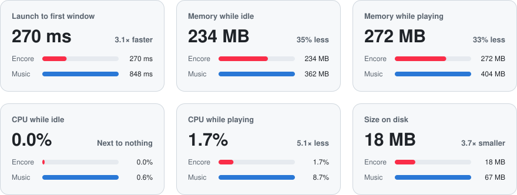

<div align="center">


# Encore

**An Apple Music client for macOS, written in Rust with [GPUI](https://www.gpui.rs).**

Styled after the macOS Tahoe Music app, with iOS-style detail pages and full-length playback for subscribers.

[Features](#features) · [Screenshots](#screenshots) · [Benchmarks](#benchmarks) · [Install](#install) · [Contributing](CONTRIBUTING.md)

</div>

<p align="center">
  
</p>

## Features

- **Your Apple Music library**, playlists and favorites, with full songs for subscribers
- **Synced lyrics**, crossfade and gapless playback
- **Pages that take on the artwork's colors**, with parallax headers
- **Quick search (⌘K)** across your library and the catalog
- **Mini Player (⇧⌘M)** that stands in for the main window
- **Trackpad gestures**: swipe back and forward, swipe the player to skip
- **A real Mac app**: media keys, Control Center, VoiceOver, menus for everything
- **Fast and light**: launches in a quarter of a second, 120 fps scrolling

[All features →](docs/features.md)

## Screenshots

<p align="center">
  
  
</p>
<p align="center"><sub><b>Home</b> with the floating player bar &nbsp;·&nbsp; <b>New</b> this week</sub></p>

<p align="center">
  
  
</p>
<p align="center"><sub><b>Album pages</b> tinted from the artwork &nbsp;·&nbsp; <b>Quick search</b> with ⌘K</sub></p>

<p align="center">
  
  
</p>
<p align="center"><sub><b>Welcome</b> on a new install &nbsp;·&nbsp; <b>Guided setup</b> for your own MusicKit key</sub></p>

<p align="center">
  
</p>
<p align="center"><sub><b>Mini Player</b> with ⇧⌘M</sub></p>

<sub>Album artwork is replaced with stand-in gradients. [CONTRIBUTING.md](CONTRIBUTING.md) explains how to take and frame these.</sub>

## Benchmarks

Against Apple's Music app on the same Mac, both signed in and streaming full songs. Lower is better.

<picture>
  <source media="(prefers-color-scheme: dark)" srcset="docs/benchmarks-dark.svg">
  
</picture>

<sub>Apple M4 Max, macOS 26.5.2, Encore 0.1.0 and Music 1.6.5. Memory and CPU include each app's helper processes; CPU is a 30-second average of one core. [Full results and how they're measured →](docs/benchmarks.md)</sub>

## Install

Encore needs macOS 13 or later. Full songs need macOS 14 and an Apple Music subscription.

**Download a release** (Apple silicon)

1. Get the zip from the [latest release](https://github.com/cpreston321/encore/releases/latest), unzip it, and move `Encore.app` to Applications.
2. Open it. This build isn't signed with a Developer ID, so macOS blocks it the first time.
3. In **System Settings → Privacy & Security**, click **Open Anyway** next to the message about Encore.

**Or build it yourself**

```sh
git clone https://github.com/cpreston321/encore.git && cd encore && ./scripts/install.sh
```

The script installs anything missing (the Xcode Command Line Tools and Rust), then builds Encore into `~/Applications`. Apps you build yourself open without the warning. To update, run `git pull && ./scripts/install.sh`.

## Signing in

Releases are ready to sign in: click **Sign In to Apple Music** and finish in your browser. Your Apple ID password only goes to Apple, and Encore keeps the sign-in in your Keychain.

Builds from source need a MusicKit key from an Apple Developer account. The welcome screen walks you through adding one, and [docs/musickit.md](docs/musickit.md) explains it step by step. Without a key, Encore still browses the charts and plays 30-second previews.

<details>
<summary><b>Keyboard shortcuts</b></summary>

| Shortcut | Action |
| --- | --- |
| <kbd>Space</kbd> | Play / pause |
| <kbd>⌘</kbd> <kbd>←</kbd> / <kbd>⌘</kbd> <kbd>→</kbd> | Previous / next track |
| <kbd>⌘</kbd> <kbd>↑</kbd> / <kbd>⌘</kbd> <kbd>↓</kbd> | Volume up / down |
| <kbd>⌘</kbd> <kbd>K</kbd> or <kbd>/</kbd> | Quick search |
| <kbd>⌘</kbd> <kbd>F</kbd> | Search page |
| <kbd>⌘</kbd> <kbd>[</kbd> / <kbd>⌘</kbd> <kbd>]</kbd> | Back / forward |
| <kbd>⌘</kbd> <kbd>1</kbd> … <kbd>⌘</kbd> <kbd>9</kbd> | Home, New, Radio, Recently Added, Artists, Albums, Songs, Playlists, Favorites |
| <kbd>⌘</kbd> <kbd>L</kbd> | Go to the current song |
| <kbd>⌃</kbd> <kbd>⌘</kbd> <kbd>F</kbd> | Now Playing |
| <kbd>⇧</kbd> <kbd>⌘</kbd> <kbd>L</kbd> | Lyrics |
| <kbd>⇧</kbd> <kbd>⌘</kbd> <kbd>M</kbd> | Mini Player |
| <kbd>⌥</kbd> <kbd>⌘</kbd> <kbd>U</kbd> | Playing Next |
| <kbd>⌘</kbd> <kbd>R</kbd> | Refresh library |
| <kbd>↑</kbd> <kbd>↓</kbd> <kbd>Return</kbd> | Move through a list and play |
| <kbd>⌘</kbd> <kbd>/</kbd> | Show all shortcuts |

</details>

<details>
<summary><b>Where things are stored</b></summary>

| What | Where |
| --- | --- |
| Music User Token | Keychain, service `Encore` |
| MusicKit key config, local library (when signed out), settings, the last queue and position | `~/Library/Application Support/Encore/` |
| Artwork, previews, cached pages and library | `~/Library/Caches/Encore/` |

To sign out, click your name in the sidebar. To reset everything, delete the two folders and the Keychain item.

</details>

## Limitations

These come from Apple's APIs, not from Encore:

- **Full songs need a subscription.** Apple only streams complete songs to its own players, so Encore plays them through MusicKit.
- **Volume control asks for System Audio Recording.** MusicKit has no volume control on macOS, so Encore routes the player's audio through itself. Nothing is recorded; decline, and the slider changes the Mac's volume instead.
- **Playlists can be added to, but not edited.** The API can't remove or reorder songs.
- **Lyrics come from LRCLIB.** Apple doesn't share its lyrics, so some songs have none.

## Development

```sh
cargo run --release                 # run without installing
./scripts/build.sh                  # build and install Encore.app, signed with your certificate
cargo test && cargo clippy --all-targets
```

- [CONTRIBUTING.md](CONTRIBUTING.md): debugging tools, signing and releasing.
- [docs/architecture.md](docs/architecture.md): how the code is laid out.
- [`crates/tahoe`](crates/tahoe/README.md): Encore's buttons, headers, cards, theme and motion as a reusable library for GPUI apps. `cargo run -p tahoe --example gallery` shows them all.

## Acknowledgements

[GPUI](https://www.gpui.rs) from [Zed](https://zed.dev) · [LRCLIB](https://lrclib.net) for lyrics · [rodio](https://github.com/RustAudio/rodio) and [Symphonia](https://github.com/pdeljanov/Symphonia) for previews · [objc2](https://github.com/madsmtm/objc2) for the macOS bindings

## License

[MIT](LICENSE).

Encore isn't affiliated with or endorsed by Apple. Apple Music, MusicKit and macOS are trademarks of Apple Inc.
