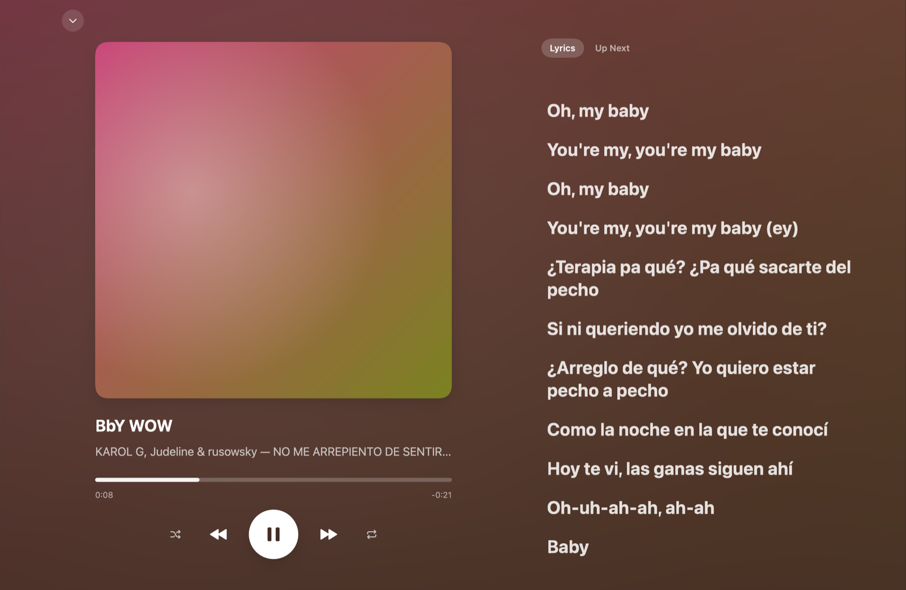
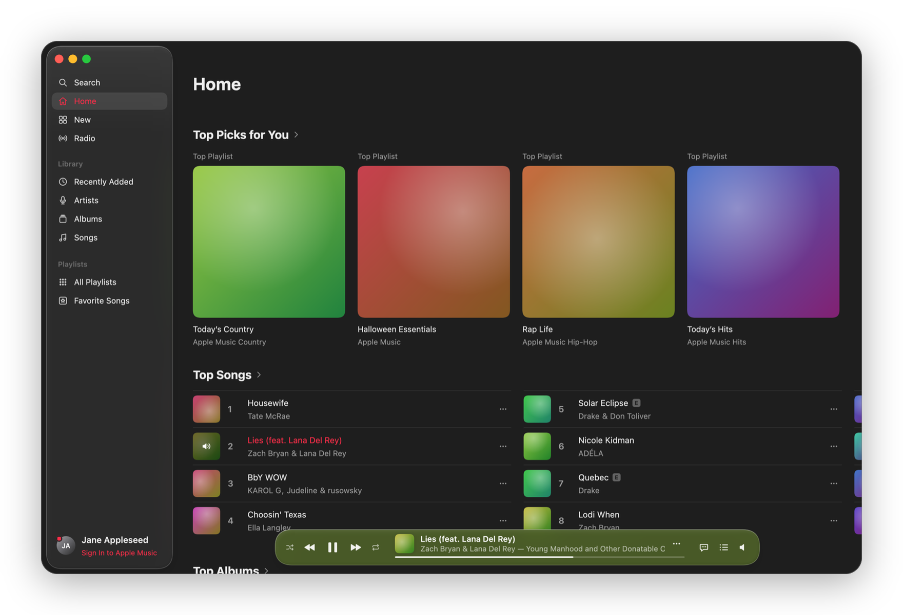
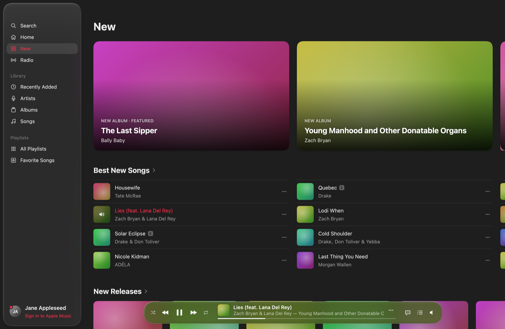
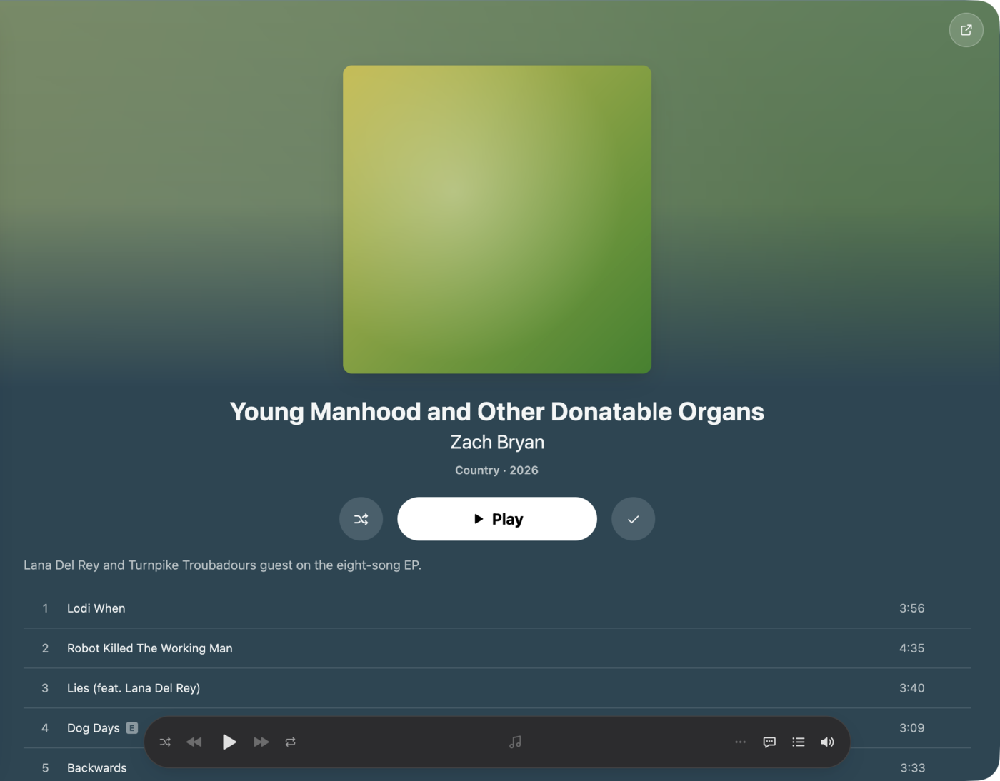
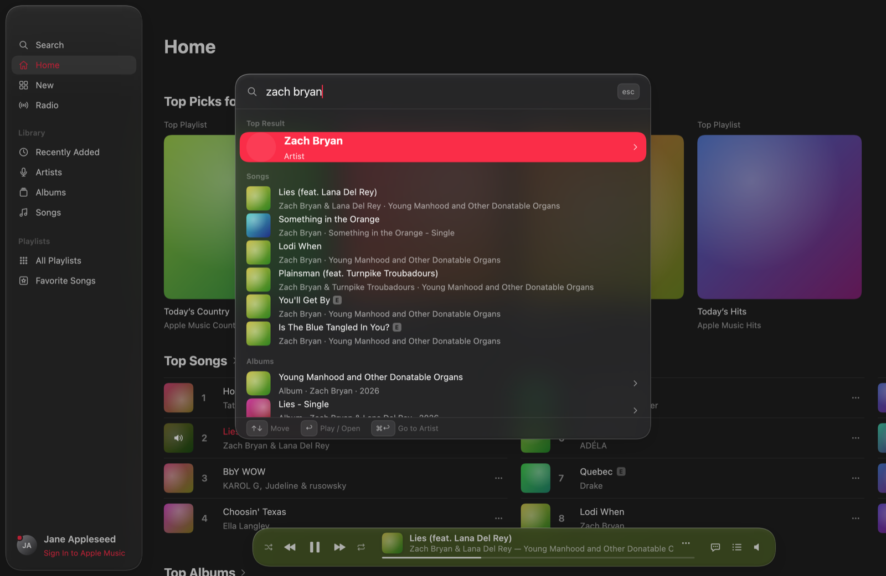
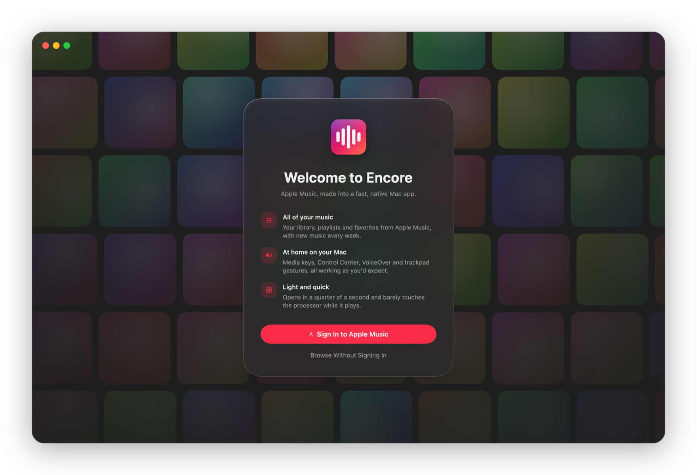
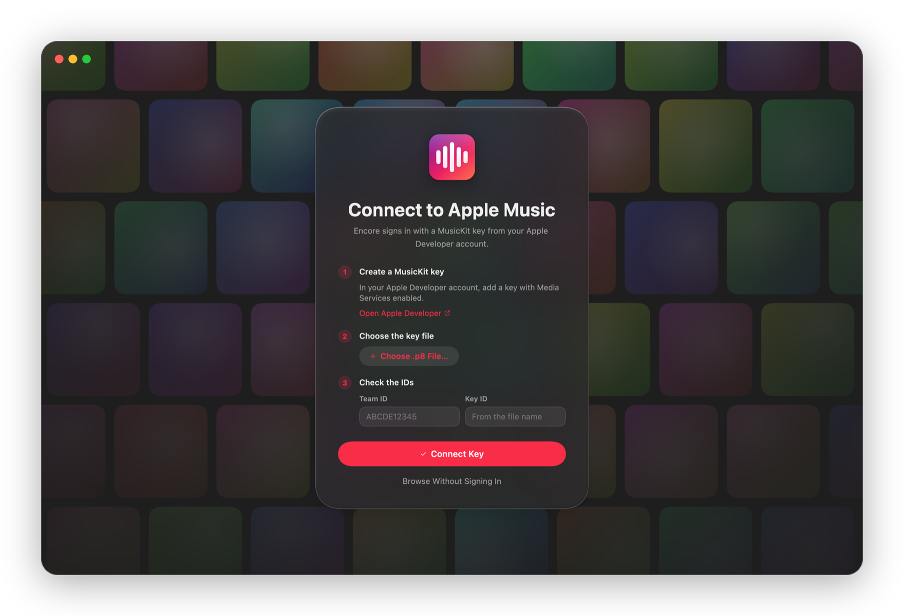
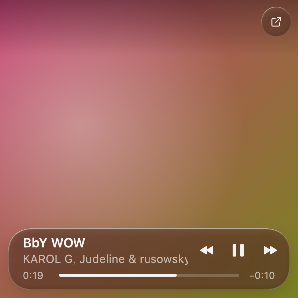

<div align="center">


# Encore

**An Apple Music client for macOS, written in Rust with [GPUI](https://www.gpui.rs).**

Styled after the macOS Tahoe Music app, with iOS-style detail pages and full-length playback for subscribers.

[Features](#features) · [Getting started](#getting-started) · [Apple Music setup](docs/musickit.md) · [Architecture](docs/architecture.md) · [Benchmarks](docs/benchmarks.md) · [Contributing](CONTRIBUTING.md)

</div>



## Features

- **Your library.** Sign in with your Apple Music account to browse your Recently Added, Artists, Albums, Songs, playlists and Favorite Songs. You can also add to your library and playlists.
- **Full songs.** Subscribers hear complete tracks through Apple's native MusicKit player on macOS 14 and later, or through MusicKit JS in a hidden web view on macOS 13. Everyone else gets 30-second previews.
- **Crossfade and gapless playback.** Choose a 3, 6 or 12 second crossfade, or none. Consecutive album tracks hand off without a gap, which the native player does by itself. Since there's only one native player, a crossfade plays the incoming song on a web player while the outgoing one fades out, and the two swap each track.
- **Animate Artwork (optional).** View → Animate Artwork makes hero cards, album, playlist and artist headers, and Now Playing slowly drift and zoom, a stand-in for Apple Music's motion artwork, which the public API doesn't provide. It's off by default, pauses while Encore isn't the active app, and respects Reduce Motion.
- **Picks up where you left off.** Quit midway through a song and Encore reopens on it, paused at the same spot with the rest of the queue intact.
- **Synced lyrics.** Lyrics come from [LRCLIB](https://lrclib.net) and follow along with the song. Click a line to jump there.
- **Detail pages that take on the artwork's colors.** Album, artist and playlist pages tint to match their artwork, the header moves with parallax, and a compact title bar fades in as you scroll.
- **Quick search (⌘K).** Spotlight-style results show a top result, artists, albums, songs and playlists from both your library and the Apple Music catalog.
- **Easy to set up.** A new install opens on a welcome screen that signs you in and only shows the app once your library has loaded. Without a MusicKit key, it walks you through adding one: a link to Apple's key page, a file picker for the `.p8` file, and a check with Apple before saving.
- **A Mac app first.** Media keys and Control Center's Now Playing work. There are Dock menu controls, a menu bar item for every page, and full keyboard navigation.
- **Mini Player (⇧⌘M).** A small floating window with the cover, and the player bar's glass, scrubber and controls on hover. It stands in for the main window, which hides while it's open, and remembers where you put it.
- **Trackpad gestures.** Swipe sideways with two fingers to go back and forward, swipe the player to skip songs, scroll over the volume to change it, and shelves settle on a tile when you let go. Scroll views stretch and bounce at their edges, as in AppKit.
- **See All.** Every shelf opens a full page: 200 entries deep for the charts, and up to 100 of an artist's top songs.
- **Visualizer.** Hovering the progress bar shows a live spectrum of the song as it plays. Before volume control is on, or on the web player, it's computed from the song's preview instead.
- **Library tools.** Sort and filter your Songs, Favorites and Albums. ⌘-click or ⇧-click to select several songs, and drag songs onto a playlist or into Playing Next.
- **Fast and accessible.** Encore scrolls and animates at 120 fps on ProMotion displays. It launches in about a quarter of a second and uses less CPU than Music.app while playing ([benchmarks](docs/benchmarks.md)). It follows the system's light or dark appearance and honors Reduce Motion.

<table>
  <tr>
    <td width="50%"></td>
    <td width="50%"></td>
  </tr>
  <tr>
    <td></td>
    <td></td>
  </tr>
  <tr>
    <td></td>
    <td></td>
  </tr>
</table>

<p align="center">
  
</p>

The screenshots use stand-in gradients in place of album artwork (`ENCORE_TOUR_PLACEHOLDER_ART`); [CONTRIBUTING.md](CONTRIBUTING.md) explains how to take them.

## Getting started

Encore runs on macOS 13 or later. The native player needs macOS 14, and its volume control needs 14.2. The design targets macOS 26 Tahoe.

### Install from source

```sh
git clone https://github.com/cpreston321/encore.git
cd encore
./scripts/install.sh
```

The script checks for the Xcode Command Line Tools and [Rust](https://rustup.rs) 1.88 or later and offers to install what's missing. It then builds `Encore.app` and installs it to `~/Applications`. An app built on your own Mac isn't quarantined, so macOS opens it without asking. To update, run `git pull && ./scripts/install.sh`.

### Install a release

Each [release](https://github.com/cpreston321/encore/releases) has a zip of `Encore.app` for Apple silicon Macs, signed ad hoc rather than with a Developer ID. Releases can sign in to Apple Music without any setup (see [Sign in to Apple Music](#sign-in-to-apple-music)).

1. Download and unzip it, and move `Encore.app` to Applications.
2. Open it. macOS says it can't check the app for malicious software.
3. Open **System Settings → Privacy & Security**, scroll down to the message about Encore, and click **Open Anyway**. On macOS 15 and later, right-clicking the app and choosing **Open** no longer skips this.

Alternatively, sign the downloaded app with your own certificate. That also stops macOS asking about it, and keeps the Keychain's **Always Allow** in effect across updates:

```sh
./scripts/sign.sh /Applications/Encore.app
```

### Signing

`scripts/sign.sh` signs with, in order:

1. `ENCORE_SIGN_IDENTITY` (a certificate's name, or `-` for ad hoc);
2. your Apple Development certificate;
3. your Developer ID Application certificate;
4. ad hoc.

`scripts/build.sh` signs every build with it. macOS remembers Keychain access per code signature, so with a certificate the Keychain stops asking after each build. Ad hoc signatures change with every build, so the prompt comes back.

### Run it while developing

```sh
cargo run --release
```

Encore works without any setup. It uses Apple's public charts and the iTunes Search API, and plays 30-second previews. `./scripts/build.sh` builds and installs the app bundle, with its icon and Info.plist.

### Sign in to Apple Music

Releases come with a MusicKit developer token built in, so you can sign in straight away. Apple limits a token to six months, so each release's token lasts 180 days; after that, update to a newer release or connect a key of your own.

Builds from source need a MusicKit key from an Apple Developer account. [docs/musickit.md](docs/musickit.md) walks through creating one and pointing Encore at it, and the app's welcome screen does the same. A key of your own always takes the place of a release's token. Then:

1. Click **Sign In** at the bottom of the sidebar.
2. Encore opens a one-page sign-in site on `localhost` in your browser. Your Apple ID password only goes to Apple.
3. The page hands the Music User Token back to Encore, which stores it in your Keychain.

## Keyboard shortcuts

| Shortcut | Action |
| --- | --- |
| <kbd>Space</kbd> | Play / pause |
| <kbd>⌘</kbd> <kbd>←</kbd> / <kbd>⌘</kbd> <kbd>→</kbd> | Previous / next track |
| <kbd>⌘</kbd> <kbd>↑</kbd> / <kbd>⌘</kbd> <kbd>↓</kbd> | Volume up / down |
| <kbd>⌘</kbd> <kbd>K</kbd> or <kbd>/</kbd> | Quick search |
| <kbd>⌘</kbd> <kbd>F</kbd> | Search page |
| <kbd>⌘</kbd> <kbd>[</kbd> / <kbd>⌘</kbd> <kbd>]</kbd> | Back / forward |
| <kbd>⌘</kbd> <kbd>1</kbd> … <kbd>⌘</kbd> <kbd>9</kbd> | Home, New, Radio, Recently Added, Artists, Albums, Songs, Playlists, Favorites |
| <kbd>⌘</kbd> <kbd>L</kbd> | Go to the current song |
| <kbd>⌃</kbd> <kbd>⌘</kbd> <kbd>F</kbd> | Now Playing |
| <kbd>⇧</kbd> <kbd>⌘</kbd> <kbd>L</kbd> | Lyrics |
| <kbd>⇧</kbd> <kbd>⌘</kbd> <kbd>M</kbd> | Mini Player |
| <kbd>⌥</kbd> <kbd>⌘</kbd> <kbd>U</kbd> | Playing Next |
| <kbd>⌘</kbd> <kbd>R</kbd> | Refresh library |
| <kbd>↑</kbd> <kbd>↓</kbd> <kbd>Return</kbd> | Move through a list and play |
| <kbd>⌘</kbd> <kbd>/</kbd> | Show all shortcuts |

## Limitations

These limits come from Apple's APIs, not from Encore:

- **Full-length playback needs a MusicKit key and an Apple Music subscription.** Apple only streams complete songs to its own players: MusicKit's native player, or MusicKit JS in a hidden web view.
- **Volume control for the native player needs System Audio Recording permission.** MusicKit has no volume control on macOS. So the first time you change the volume or crossfade setting, Encore asks to route the player's audio through itself using a Core Audio process tap. Nothing is recorded. If you decline, the slider changes the Mac's volume instead, and track changes don't crossfade.
- **Playlists can be added to, but not edited.** The API can add songs and create playlists. It can't remove or reorder songs, and it can't delete anything from your library.
- **Lyrics come from LRCLIB.** Apple doesn't share its own lyrics with third-party apps, so some songs have none.

## Where things are stored

| What | Where |
| --- | --- |
| Music User Token | Keychain, service `Encore` |
| MusicKit key config, local library (when signed out), settings, the last queue and position | `~/Library/Application Support/Encore/` |
| Artwork, previews, cached pages and library | `~/Library/Caches/Encore/` |

To sign out, click your name in the sidebar. To reset everything, delete the two folders and the Keychain item.

## Development

```sh
cargo test                    # unit tests
cargo test -- --ignored       # also hits the live public endpoints
cargo clippy --all-targets
cargo fmt
ENCORE_PERF=1 cargo run --release   # frame times, request durations and startup milestones on stderr
```

To release, bump `version` in `Cargo.toml` and push a matching tag (`v0.2.0`). The [release workflow](.github/workflows/release.yml) builds the app and attaches it to a draft release, which stays unpublished until you publish it. It needs the `MUSICKIT_TEAM_ID`, `MUSICKIT_KEY_ID` and `MUSICKIT_PRIVATE_KEY` (the `.p8` file's contents) repository secrets: it signs a 180-day developer token with them and builds it into the app, and the key itself goes no further. Release at least every six months, or sign-in stops working for people without a key of their own.

[CONTRIBUTING.md](CONTRIBUTING.md) covers the debug tools, and [docs/architecture.md](docs/architecture.md) explains how the code is laid out.

## Tahoe components

Encore's buttons, links, headers, cards, theme and motion live in a reusable library, [`crates/tahoe`](crates/tahoe/README.md), for other GPUI apps that want to look at home on macOS Tahoe. `cargo run -p tahoe --example gallery` shows them all.

## Acknowledgements

- [GPUI](https://www.gpui.rs), the UI framework from [Zed](https://zed.dev).
- [LRCLIB](https://lrclib.net) for synced lyrics.
- [rodio](https://github.com/RustAudio/rodio) and [Symphonia](https://github.com/pdeljanov/Symphonia) for preview playback.
- [objc2](https://github.com/madsmtm/objc2) for the AppKit, WebKit and MediaPlayer bindings.

## License

[MIT](LICENSE).

Encore isn't affiliated with or endorsed by Apple. Apple Music, MusicKit and macOS are trademarks of Apple Inc.
