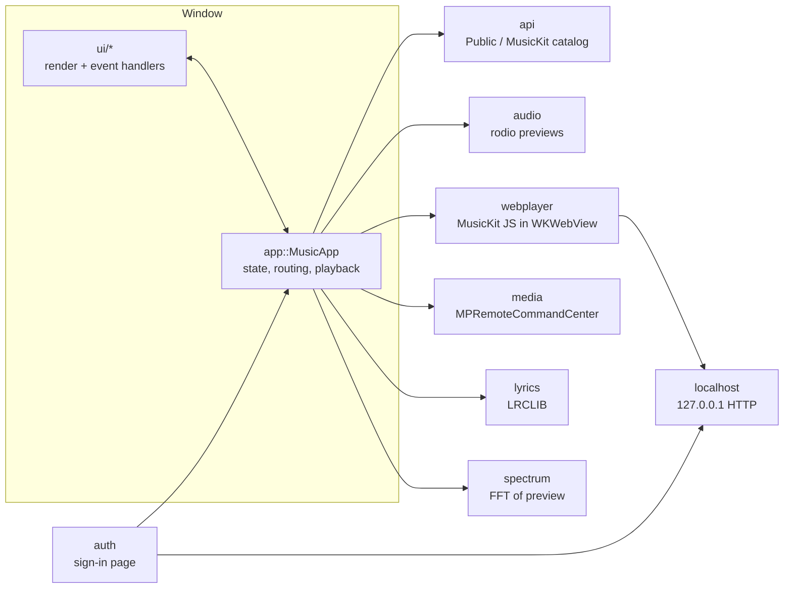

# Architecture

Encore is a single GPUI application. One root view, `MusicApp`, owns all the app state. The window is drawn as three cached regions (page, player and sidebar) plus the root's overlays. Its behavior is split into **`app/`**, which holds state and logic, and **`ui/`**, which does the drawing. Both add `impl MusicApp` blocks for one area each. Everything that talks to the outside world, such as Apple's APIs, audio, WebKit and the system, lives in its own flat module at the top of `src/`.



## Source layout

```text
src/
├── main.rs          App entry: menus, Dock menu, window, bundled icons
├── app/             State and behavior of the root view
│   ├── mod.rs       MusicApp struct, shared types (Route, Load, PlayState…), key handling, Render
│   ├── account.rs   Sign-in, sign-out, the user's library and personal Home
│   ├── data.rs      Background loading: charts, albums, artists, playlists, search
│   ├── media.rs     Artwork downloads, artwork colors, hover and fade state
│   ├── navigation.rs  Routes, back/forward history, scroll restoration
│   ├── playback.rs  Queue, both audio engines, crossfade, gapless, volume, Now Playing info
│   ├── settings.rs  Persisted preferences (crossfade, folded sidebar sections, recent searches)
│   └── tour.rs      Debug-only scripted tour for screenshots and profiling
├── ui/              Everything drawn on screen
│   ├── mod.rs       Shared imports and layout constants
│   ├── shell.rs     Window frame: sidebar, account popover, main area, context menus
│   ├── player.rs    Floating player bar, volume popover, Playing Next panel
│   ├── progress.rs  Progress bar view, which decides when playback needs a redraw
│   ├── regions.rs   Page, player and sidebar as cached views
│   ├── pages.rs     Routing plus Home, New, Radio and Search
│   ├── library.rs   Recently Added, Albums, Artists, Songs, playlists
│   ├── detail.rs    Album / artist / playlist pages tinted from the artwork, with parallax
│   ├── now_playing.rs  Full-window Now Playing with lyrics and Up Next
│   ├── palette.rs   Quick search (⌘K)
│   ├── mini.rs      Mini Player window
│   ├── list_tools.rs   Sort, filter and multi-select
│   ├── playlists.rs Add to Playlist / New Playlist
│   ├── shortcuts.rs Keyboard shortcuts sheet
│   ├── components.rs   Stateful pieces: artwork, song rows, tiles, menus
│   └── widgets.rs   Stateless pieces: icons, buttons, headers, placeholders
├── api.rs           Catalog backends, HTTP agent, disk cache, token signing
├── auth.rs          Apple Music sign-in and Keychain storage
├── webplayer.rs     Hidden MusicKit JS player for full songs
├── localhost.rs     Minimal HTTP server shared by auth and webplayer
├── audio.rs         Preview playback with rodio
├── spectrum.rs      Radix-2 FFT for the visualizer
├── lyrics.rs        LRCLIB lookup and LRC parsing
├── media.rs         Media keys and Control Center
├── queue.rs         Play order, shuffle, repeat
├── library.rs       Local library used when signed out
├── model.rs         Song, Album, Artist, Playlist…
├── keys.rs          Actions, key bindings, list navigation, search matching
├── textfield.rs     Single-line text editing for search fields
├── theme.rs         Light and dark palettes
├── anim.rs          Reversible open/close transitions and color blends
├── chrome.rs        Native window tweaks GPUI doesn't expose
└── perf.rs          Opt-in frame and request timing
```

**Rule of thumb:** `ui/` reads state and calls methods on `MusicApp`. It doesn't do I/O. `app/` decides what to load and play, and the top-level modules do the work.

## Catalog: two backends

`api::Catalog` chooses its backend once, at launch:

| | `Public` | `MusicKit` |
| --- | --- | --- |
| Needs | nothing | a MusicKit key ([setup](musickit.md)) |
| Charts | `rss.marketingtools.apple.com` | Apple Music API charts |
| Details, search | iTunes Search / Lookup | `api.music.apple.com` |
| Library | local `library.json` | the user's Apple Music library (needs sign-in) |
| Playback | 30 s previews | full songs via the web player, previews as fallback |

Every API call blocks, so `app/data.rs` runs them on GPUI's background executor and stores the result in a `Load<T>` (`Loading`, `Ready`, `Failed`). Pages render placeholders while data loads, sized like the real content so nothing shifts. Charts, the remote library and personal Home are cached on disk and shown right away on the next launch while fresh data loads.

## Playback

`MusicApp.audio` holds an `Audio` value. It's either `Preview`, played by rodio from a downloaded file, or `Full`, played by `webplayer::WebPlayer`. Both expose the same small interface: play, pause, seek, volume, position and duration. That lets the queue, crossfade and player UI ignore which engine is active.

- **Full songs.** Apple only streams complete tracks to its own players. `WebPlayer` loads MusicKit JS into an offscreen `WKWebView` from a page served on `127.0.0.1`. The page long-polls `/cmd` for commands, so the request waits until there's something to do. It posts its state to `/state`. Both are keyed with a random token. A load sequence number makes sure a late error from an earlier song is ignored.
- **Crossfade.** Near the end of a track, the playing engine moves to a fade-out slot. The next song starts silently in a fresh one, and `step_fade` trades their volumes every 30 ms.
- **Gapless playback.** For consecutive tracks on the same album, the next track starts `GAPLESS_LEAD` (1.2 s) before the current one ends, and the two swap in a 120 ms handoff instead of an audible fade.
- **System integration.** `media.rs` registers for media key and Control Center commands and publishes the Now Playing info.

## Sign-in

Apple only issues Music User Tokens through MusicKit JS's `authorize()` in a browser. `auth::SignInServer` serves a one-page site on a random localhost port and opens it. The page posts the token back along with a per-session `state` value. Requests without the right `state` are rejected. The server stops when sign-in finishes, is cancelled, or times out after 10 minutes. The token goes into the Keychain through the `keyring` crate.

## Rendering and performance

- **Cached regions for 120 Hz.** `ui/regions.rs` renders the page, player and sidebar as cached GPUI views. GPUI replays a cached view's previous frame until that view is notified. Scrolling or a hover fade redraws only the page, and a playback tick only the player.
  - App state changes still redraw every region, because each region observes `MusicApp`.
  - A notify on any view also dirties its ancestors, so the player lives beside the page rather than inside it.
  - Transitions that belong to one region request that region's frames (`Fx::region_animating`). Overlays drawn by the root request the root's frames.
- **Playback redraws when something moves.** The progress bar redraws only when its fill advances half a point, a few times a second. When it's hovered, the times and visualizer update at the display's refresh rate. Now Playing and the Mini Player move with a 200 to 250 ms tick.
- **Virtualized lists.** Libraries with thousands of songs use `uniform_list`. Grids switch to virtual rows above `VIRTUAL_GRID_MIN` items.
- **Artwork.** Images are downloaded once to `~/Library/Caches/Encore/art` on the background executor. Each artwork's tint color is averaged from a small thumbnail, also in the background, and kept in memory.
- **Animation.** Transitions use GPUI's `with_animation` or the reversible `anim::Presence`. Everything checks `anim::reduce_motion()`.
- **Measuring.** `ENCORE_PERF=1` logs startup milestones, each request's duration, and per-page frame statistics (average, p95, max, and frames over the 8.3 ms a 120 Hz display allows, and the frame rate reached while animating) every 5 seconds.

## Native glue

GPUI doesn't cover everything a Mac app needs, so `objc2` bindings fill the gaps:

- `chrome.rs` adds an empty `NSToolbar`, which gives the window Tahoe's larger corner radius.
- `webplayer.rs` hosts WebKit.
- `media.rs` uses MediaPlayer.
- `ui/mini.rs` opens a second, floating window.
